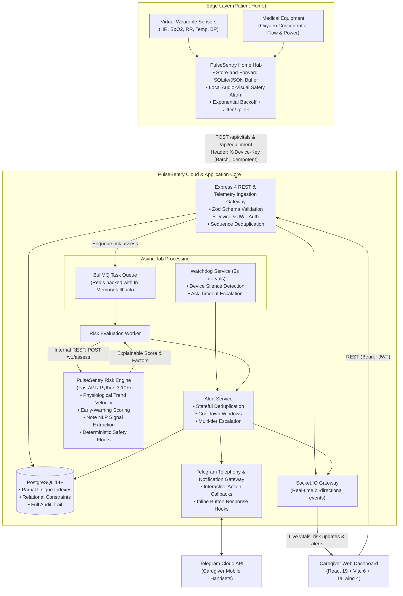
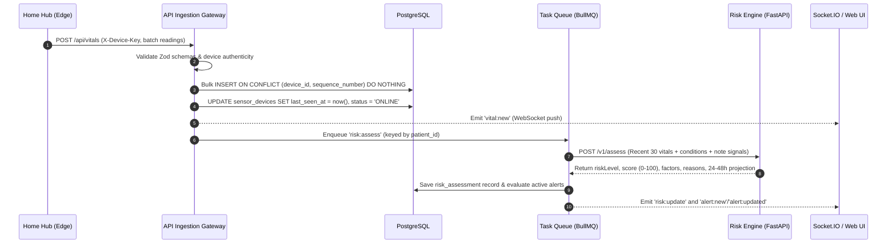
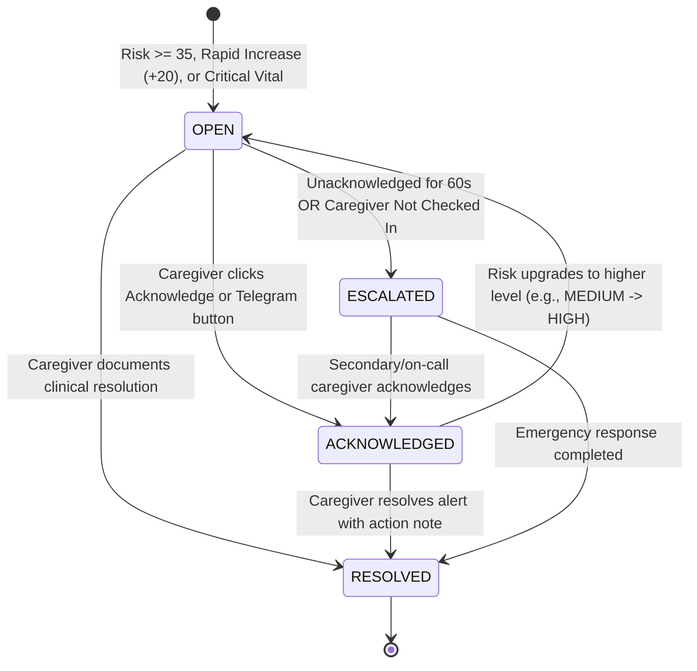

# PulseSentry System Architecture & Design Specification

> **PulseSentry: Real-Time Edge-to-Cloud Remote Patient Monitoring & Deterioration Detection Platform**

---

## 1. Architectural Overview

PulseSentry is designed for hospital-at-home and remote acute care scenarios. It bridges high-frequency physiological telemetry (IoT wearables and medical equipment) with an explainable clinical decision support engine, an automated alert state machine, and real-time caregiver interfaces.



---

## 2. Core Components & Responsibilities

| Tier / Subsystem | Primary Technologies | Key Responsibilities |
|---|---|---|
| **Edge Telemetry Simulator** | Node.js (ESM), Express | Simulates physiological baseline drifting, respiratory distress, oxygen drop, and device failures. Manages atomic local file buffers (`FileStore`) and edge audible alarms (`hubAlarms.js`). |
| **Ingestion Gateway** | Express 4, Zod, Helmet | Authenticates devices via `X-Device-Key`, enforces strict timestamp and physiological range validation, prevents duplicate replay attacks using sequence numbers. |
| **Data Layer** | PostgreSQL (`pg`), Embedded Postgres | 13 tables enforcing ACID invariants, partial unique indexes (`uq_alerts_one_active`), cascade deletes for patient data, and append-only audit logs. |
| **Risk Engine** | Python 3.10+, FastAPI, Pydantic | Analyzes sliding-window trend velocity ($R^2$ regression slope), clinical symptom signals from free-text notes, and enforces clinical safety floors (NEWS2 adaptation). |
| **Alert & Escalation Engine** | Node.js, BullMQ, Redis | Evaluates risk deltas, suppresses duplicate alarms at current or lower severity, enforces 60s cooldown windows post-resolution, and escalates to secondary channels if unacknowledged. |
| **Presentation Layer** | React 19, Recharts, Tailwind CSS 4 | Real-time clinical telemetry streaming, animated risk trajectory graphs, interactive alert lifecycle actions, and caregiver attendance check-ins. |

---

## 3. End-to-End Data Flow

### A. Telemetry Ingestion & Idempotency Pipeline
1. **Edge Sampling:** Every 2 seconds, simulated wearables sample Heart Rate, SpO₂, Respiration Rate, Temperature, and BP.
2. **Local Buffer Write:** Samples are stamped with a monotonic, per-device `sequence_number` and written to local storage before network transmission.
3. **HTTP Uplink:** Batches (up to 500 items) are dispatched to `POST /api/vitals` with header `X-Device-Key`.
4. **Idempotent Ingestion:** The database layer inserts readings with `ON CONFLICT (device_id, sequence_number) DO NOTHING`. If a packet is resent due to network interruption, duplicates are safely counted and discarded without data corruption.
5. **Real-time Fanout:** For live readings, `vital:new` events are published to connected caregiver dashboards via Socket.IO.
6. **Async Trigger:** A `risk:assess` task is enqueued for the patient.



---

## 4. Explainable Clinical Risk Engine

The risk engine computes an explainable 0–100 risk score and categorizes patients into three clinical tiers:
- **LOW (0–34):** Stable physiological state. Routine monitoring.
- **MEDIUM (35–64):** Early deterioration signs or moderate single-vital anomalies. Requires clinical review within 30 minutes.
- **HIGH (65–100):** Severe acute deterioration or critical physiological violation. Requires immediate caregiver intervention.

### Mathematical Scoring Breakdown
$$\text{RiskScore} = \min\Big(100, \, \max\big(\text{SafetyFloor}, \, S_{\text{vitals}} + S_{\text{trends}} + S_{\text{combined}} + S_{\text{context}} + S_{\text{notes}} - S_{\text{recovery}}\big)\Big)$$

1. **Current Vital Score ($S_{\text{vitals}}$):**
   - Uses the **median of the last 3 readings** to eliminate single-point sensor noise.
   - Evaluates early-warning bands (0–3 points per vital): SpO₂, Respiration Rate, Heart Rate, Systolic BP, Temperature. Each point corresponds to $+5$ score points.
2. **Trend Velocity ($S_{\text{trends}}$):**
   - Compares the mean of the first 3 samples against the last 3 samples across a 20-sample sliding window:
     - $\text{SpO}_2 \downarrow \ge 2\%$: $+6$ pts ($+10$ if $\ge 4\%$).
     - $\text{Heart Rate} \uparrow \ge 8\text{ bpm}$: $+6$ pts ($+10$ if $\ge 16\text{ bpm}$).
     - $\text{Respiration Rate} \uparrow \ge 3\text{ breaths/min}$: $+6$ pts ($+10$ if $\ge 6$).
     - $\text{Temperature} \uparrow \ge 0.4^\circ\text{C}$: $+6$ pts.
     - $\text{Systolic BP} \downarrow \ge 10\text{ mmHg}$: $+6$ pts.
3. **Compound Deterioration ($S_{\text{combined}}$):**
   - 2 worsening parameters simultaneously: $+8$ pts.
   - 3+ worsening parameters simultaneously: $+15$ pts.
4. **Patient Context ($S_{\text{context}}$):**
   - Age $\ge 65$ ($+4$ pts), age $\ge 80$ ($+8$ pts).
   - Relevant comorbid conditions (e.g., COPD or Asthma paired with respiratory anomalies: $+4$ pts, Heart Failure with cardiac anomalies: $+4$ pts). Capped at $+12$ pts.
5. **Caregiver Note Signals ($S_{\text{notes}}$):**
   - Natural language processing using regex token analysis with negation handling (e.g., "no shortness of breath" does not trigger).
   - Signal weights: `chest_discomfort` ($+12$), `breathing_difficulty` ($+10$), `confusion` ($+10$), `dizziness` ($+5$), `fatigue` ($+4$), `pain` ($+3$). Capped at $+20$ pts.
6. **Stabilization & Recovery ($S_{\text{recovery}}$):**
   - If $\ge 2$ vital parameters demonstrate improving trajectories and zero are worsening: $-10$ pts.
7. **Deterministic Safety Floors ($\text{SafetyFloor}$):**
   - Critical vitals immediately clamp risk to HIGH:
     - $\text{SpO}_2 \le 88\% \implies \text{Floor } 70$.
     - $\text{RR} \ge 30 \text{ or } \le 8 \implies \text{Floor } 70$.
     - $\text{HR} \ge 131 \text{ or } \le 40 \implies \text{Floor } 70$.
     - $\text{Systolic BP} \le 90 \implies \text{Floor } 70$.
     - $\text{Temperature} \ge 39.5^\circ\text{C} \text{ or } \le 35.0^\circ\text{C} \implies \text{Floor } 70$.
   - Red flag note signals (`chest_discomfort`, `confusion`) immediately enforce a minimum Floor of 35 (MEDIUM).

---

## 5. Alert Lifecycle & State Machine



### Key Safety Invariants:
1. **Deduplication:** Enforced by PostgreSQL partial unique index:
   ```sql
   CREATE UNIQUE INDEX uq_alerts_one_active ON alerts (patient_id, category) 
   WHERE status <> 'RESOLVED';
   ```
2. **Escalation Rules:**
   - If an alert is HIGH risk and the assigned caregiver is currently **NOT CHECKED IN**, the alert bypasses the 60-second waiting period and immediately escalates to secondary channels.
   - If an active alert is in `OPEN` state for more than `ACK_TIMEOUT_SECONDS` (default 60s), the background watchdog escalates the alert.
3. **Cooldown Window:**
   - Following resolution, the system will not create a new alert at equal or lower severity for `ALERT_COOLDOWN_SECONDS` (default 60s) to prevent alarm chatter.

---

## 6. Authentication & Security Architecture

1. **Role-Based Access Control (RBAC):**
   - `ADMIN`: Full access, including simulation control and configuration reset.
   - `CAREGIVER`: Access to assigned patient vitals, alert resolution, note entry, and attendance check-in.
2. **Device Authentication:**
   - Edge devices transmit a pre-shared cryptographic key in `X-Device-Key`.
   - Backend compares keys using constant-time comparison (`timingSafeEqual`) to prevent timing side-channel attacks.
3. **User Authentication:**
   - JWT tokens signed with HMAC-SHA256 (`jsonwebtoken`) with configurable expiration (`JWT_EXPIRES_IN=8h`).
   - Passwords hashed with `bcryptjs` with standard salt rounds.
4. **Data Privacy (HIPAA / DPDP Alignment):**
   - Risk assessment payload stripped of PII before sending to external risk engine; payload includes only patient age, medical condition categories, and numerical vital vectors.
   - All state-altering actions logged to an immutable `audit_logs` table containing user ID, IP/request context, entity IDs, and before/after payloads.

---

## 7. Fault Tolerance & Edge Resilience

1. **Network Disconnection / ISP Failure:**
   - Edge home hub detects uplink failures, buffers telemetry locally to disk, and transitions local display to "OFFLINE BUFFERING".
   - Uplink employs exponential backoff ($1\text{s} \to 30\text{s}$) with randomized jitter to prevent server stampedes upon reconnection.
   - Edge audio-visual buzzer continues to evaluate critical vital limits locally and sounds alarms even without an internet connection.
2. **Database Resilience:**
   - Connection pool managed with strict acquisition timeouts and error event handlers.
3. **Risk Engine Outage:**
   - If the Python risk engine becomes unreachable or times out, the Node.js backend automatically falls back to deterministic in-memory threshold evaluation (`fallbackRisk.js`), ensuring patient safety monitoring is never disabled.
